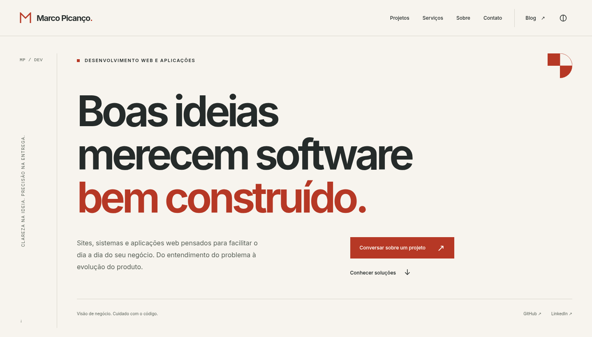
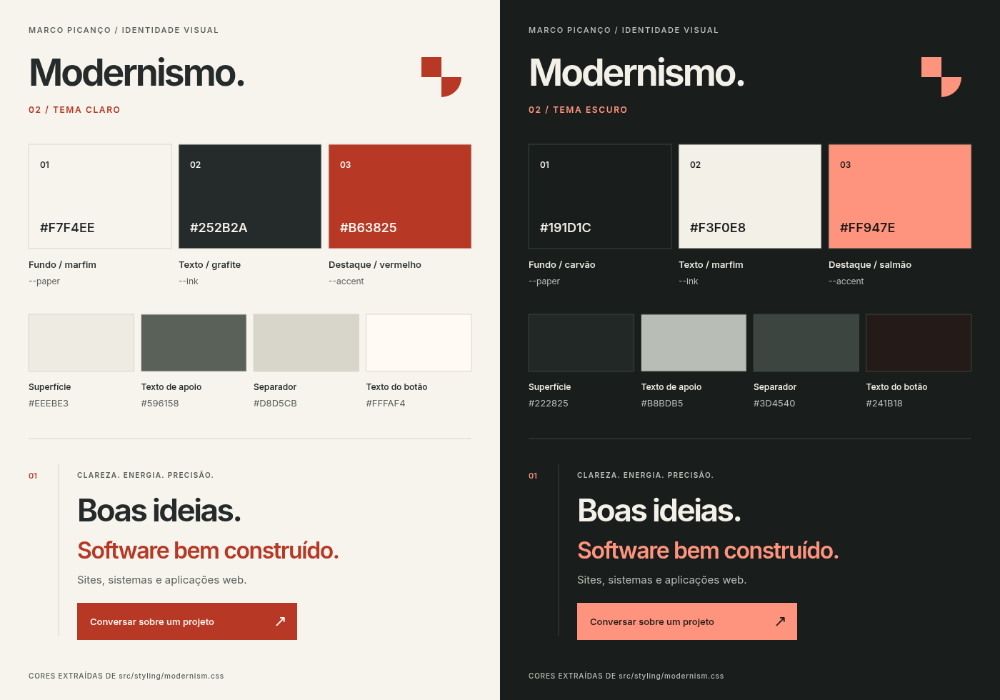
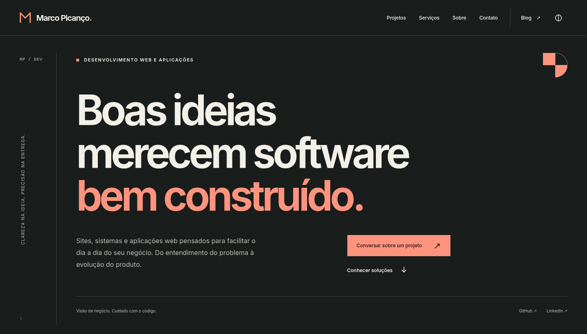

# Marco Picanço — site e blog

## Tecnologias usadas no projeto

O site é gerado estaticamente com Astro, com artigos em MDX e componentes React
para a interatividade do arquivo do blog. As tecnologias e ferramentas usadas são:

| Tecnologia                             | Uso no projeto                                                                                  |
| -------------------------------------- | ----------------------------------------------------------------------------------------------- |
| **Astro 7**                            | Estrutura de páginas, layouts, rotas e geração do site estático.                                |
| **React 18**                           | Componente interativo do arquivo do blog, com filtros de artigos por mês.                       |
| **TypeScript 6**                       | Tipagem de componentes, dados e scripts, com verificação antes do build.                        |
| **Tailwind CSS 4 e CSS personalizado** | Classes utilitárias e implementação da identidade modernista, dos temas e do layout responsivo. |
| **MDX**                                | Escrita dos artigos em Markdown com suporte a componentes.                                      |
| **Astro Expressive Code**              | Renderização dos blocos de código com destaque de sintaxe e controles de cópia.                 |
| **Vite 8**                             | Servidor de desenvolvimento e processamento dos arquivos usados no build.                       |
| **Inter Variable / Fontsource**        | Fonte variável hospedada localmente, usada na interface e na leitura dos artigos.               |
| **Node.js e npm**                      | Execução das ferramentas, gerenciamento de dependências e scripts de desenvolvimento.           |
| **ESLint e Prettier**                  | Análise estática e padronização da formatação do código.                                        |
| **axe-core CLI**                       | Verificações automatizadas de acessibilidade no navegador.                                      |
| **Node.js Test Runner e npm audit**    | Testes das regras de segurança e auditoria das dependências de produção.                        |
| **GitHub Actions**                     | Automação de lint, verificações de segurança, build e publicação.                               |
| **GitHub Pages**                       | Hospedagem dos arquivos estáticos gerados pelo Astro.                                           |
| **Cloudflare**                         | Camada de entrega e segurança do domínio, incluindo cabeçalhos HTTP e CSP.                      |

As dependências e versões declaradas estão em [`package.json`](package.json);
as versões resolvidas ficam registradas em [`package-lock.json`](package-lock.json).
As integrações e regras de build são configuradas em
[`astro.config.mjs`](astro.config.mjs).

## Identidade visual



## O motivo da escolha

A direção escolhida apresenta uma marca pessoal gráfica, direta e organizada.
O objetivo é ajudar quem chega ao site a entender o quê pode contratar, conhecer
o trabalho e encontrar um canal de contato. Tecnologias e formação aprofundam a
apresentação ao longo da página.

Quatro decisões dão forma à identidade:

- **Tipografia sem serifa e títulos de grande escala:** a mensagem principal ganha
  presença, com hierarquia construída por tamanho, peso e espaço.
- **Eixo lateral e alinhamentos compartilhados:** a linha vertical, os índices e
  as colunas organizam a leitura e conectam seções diferentes.
- **Serviços numerados e linhas finas:** as ofertas ficam fáceis de percorrer,
  com separação visual por alinhamento, espaço e divisórias.
- **Geometria e cor de destaque pontual:** quadrado, arcos, símbolo da marca e
  vermelho terroso formam uma assinatura reconhecível em pequenos detalhes.

Objetividade, energia e precisão são as intenções da composição. O nome pessoal,
o retrato e a escrita mantêm a apresentação próxima de quem realiza o trabalho.

## Paleta e combinações de cores

As amostras abaixo reproduzem os valores definidos em
[`src/styling/modernism.css`](src/styling/modernism.css). Cada tema tem suas próprias
cores de fundo, leitura, apoio e ação.



| Função / variável CSS                | Tema claro | Tema escuro | Aplicação                                          |
| ------------------------------------ | ---------- | ----------- | -------------------------------------------------- |
| Fundo · `--paper`                    | `#F7F4EE`  | `#191D1C`   | Superfície principal da página                     |
| Texto · `--ink`                      | `#252B2A`  | `#F3F0E8`   | Títulos, corpo e navegação                         |
| Apoio · `--muted`                    | `#596158`  | `#B8BDB5`   | Descrições, datas e legendas                       |
| Destaque · `--accent`                | `#B63825`  | `#FF947E`   | Ação principal, ênfase tipográfica, índices e foco |
| Texto sobre destaque · `--on-accent` | `#FFFAF4`  | `#241B18`   | Conteúdo dos botões de destaque                    |
| Divisória · `--line`                 | `#D8D5CB`  | `#3D4540`   | Linhas de organização e bordas discretas           |
| Superfície secundária · `--surface`  | `#EEEBE3`  | `#222825`   | Seção de projeto e estados de interação            |

### Tema claro: marfim, grafite e vermelho terroso

O marfim quente estabelece uma base próxima do papel e preserva espaço visual
em volta do conteúdo. O grafite tem uma leve nuance esverdeada e sustenta a
leitura dos títulos e textos. Cinza esverdeado, superfície bege e divisórias
acompanham essa base com diferenças pequenas de luminosidade.

O vermelho terroso concentra a ênfase na expressão “bem construído”, na ação
principal e nos pequenos elementos de orientação. Seu uso ocupa uma parcela
reduzida da composição. Assim, a mesma cor conecta mensagem, navegação e ação,
enquanto os textos longos permanecem em grafite.

### Tema escuro: carvão, marfim e salmão



O fundo carvão e o texto marfim mantêm a relação entre superfícies discretas e
conteúdo destacado. O salmão assume o papel do vermelho terroso, com luminosidade
adequada ao fundo escuro; o botão passa a usar texto escuro sobre esse destaque.
Texto de apoio, bordas e superfícies também recebem valores próprios.

A seção de contato utiliza uma superfície escura com destaque salmão também no
tema claro. Essa mudança de tom marca o encerramento da apresentação e repete a
combinação de cores da família escura.

### Contraste das combinações principais

Os valores abaixo foram calculados pela luminância relativa das cores sólidas
dos tokens, arredondados a duas casas decimais:

| Combinação                    | Claro   | Escuro  |
| ----------------------------- | ------- | ------- |
| Texto principal sobre fundo   | 13,12:1 | 14,95:1 |
| Texto de apoio sobre fundo    | 5,84:1  | 8,90:1  |
| Destaque sobre fundo          | 5,34:1  | 7,93:1  |
| Texto do botão sobre destaque | 5,65:1  | 7,86:1  |

Esses pares superam o mínimo de 4,5:1 para texto comum previsto no critério de
[contraste mínimo da WCAG](https://www.w3.org/WAI/WCAG22/Understanding/contrast-minimum.html).
As divisórias são elementos de organização; títulos e rótulos também identificam
o conteúdo. A verificação desses pares não equivale a uma auditoria completa de
acessibilidade.

## Tipografia, composição e imagens

### Uma família tipográfica, diferentes níveis de leitura

A [Inter Variable](https://rsms.me/inter/) reúne títulos, navegação e textos em uma
única família. A variação de peso permite títulos marcantes e textos de apoio
discretos, mantendo continuidade entre a apresentação comercial e o blog.

Na implementação, o corpo parte de 16 px; os artigos usam 17 px no desktop e
coluna limitada a `68ch`, com entrelinha de 1,9. O título da abertura usa peso 650,
espaçamento entre letras mais fechado e escala responsiva, chegando a 102 px em
telas largas. As regras para telas pequenas ajustam essa escala e a entrelinha
dos artigos.

A fonte é servida localmente em WOFF2, com preload e `font-display: swap`.
Índices e pequenas legendas técnicas usam a pilha monoespaçada do sistema,
sem carregar outra família de fonte.

### Uma malha que organiza a página

Em telas largas, o eixo lateral reserva espaço para sigla, numeração e legendas
verticais. O conteúdo começa sempre no mesmo alinhamento. Colunas de larguras
diferentes acomodam descrição, ação, fotografia e projeto; áreas vazias dão ritmo
entre esses blocos. Linhas finas repetem o alinhamento em serviços, processo e
escrita.

No celular, as colunas são empilhadas e o eixo se reorganiza em uma identificação
horizontal. A hierarquia permanece por meio dos números, títulos e espaços.
O símbolo linear da marca reaparece no favicon; a composição de quadrado e arcos
identifica a abertura e complementa essa assinatura geométrica.

## Organização do conteúdo e experiência

A página inicial apresenta uma sequência de avaliação e contato:

1. **Abertura:** o que é desenvolvido, mensagem principal e  um convite para conversar.
2. **Serviços:** sites e presença digital; sistemas e aplicações web; integrações e
   evolução, com descrição do problema atendido e contexto técnico.
3. **Projeto selecionado:** [HexaAlerts](https://github.com/marcopicanco-dev/hexa_alerts),
   criado para acompanhar os lances da Copa e praticar Redis, Sidekiq, webhooks
   idempotentes e reconciliação de partidas entre provedores. A seção mostra uma
   captura real do painel, as tecnologias e os principais desafios enfrentados.
4. **Processo:** entender, definir, construir e acompanhar.
5. **Sobre:** retrato e apresentação breve, com trajetória completa em `/sobre/`.
6. **Escrita:** textos selecionados e acesso ao arquivo em `/blog/`.
7. **Contato:** e-mail e LinkedIn como canais concretos para iniciar uma conversa.

O cabeçalho prioriza Projetos, Serviços, Sobre e Contato. O blog tem acesso próprio,
com busca e filtros dentro do arquivo. Os serviços descrevem aplicações web e
sistemas usados pelo navegador, de acordo com o escopo apresentado no conteúdo.

HTML semântico, link para pular ao conteúdo, foco visível, controles com rótulos,
menu móvel acessível por teclado e respeito a movimento reduzido fazem parte
da implementação. A leitura e as ações essenciais estão disponíveis sem depender
de passar o mouse. A validação com pessoas representativas do público continua
sendo uma etapa de evolução do projeto.

## Referências e sua aplicação no design

O brief é a origem das referências conceituais abaixo. A tabela relaciona cada
uma à interpretação aplicada neste projeto e oferece links para os autores,
editoras ou publicações originais.

| Referência                                                                                                                                                                  | Aplicação na proposta modernista                                                                                 |
| --------------------------------------------------------------------------------------------------------------------------------------------------------------------------- | ---------------------------------------------------------------------------------------------------------------- |
| Don Norman — [The Design of Everyday Things](https://jnd.org/books/the-design-of-everyday-things-revised-and-expanded-edition/)                                             | Ações identificáveis, destinos compreensíveis e controles com estados visíveis, como a seleção de tema.          |
| Steve Krug — [Don't Make Me Think](https://sensible.com/)                                                                                                                   | Navegação convencional, títulos diretos e nomes de links que antecipam o destino.                                |
| Fabrício Teixeira — [Introdução e boas práticas em UX Design](https://www.casadocodigo.com.br/products/livro-ux-user-experience)                                            | Organização da apresentação a partir das necessidades de quem procura um serviço e da tarefa de iniciar contato. |
| Senac — [UX/UI design: experiências e interfaces do usuário nos processos de design](https://www.editorasenacsp.com.br/livro/ux-ui-design-experiencias-interfaces-usuarios) | Conteúdo, interface e acessibilidade considerados juntos; validação com o público como próxima etapa.            |
| Jon Yablonski — [Laws of UX](https://lawsofux.com/)                                                                                                                         | Agrupamento por proximidade, poucas ações concorrentes e alvos de interação confortáveis.                        |
| Don Norman — [Emotional Design](https://jnd.org/emotional-design-people-and-things/)                                                                                        | Consistência entre cores, tipografia, geometria e imagens para expressar personalidade e cuidado.                |
| Ellen Lupton — [Thinking with Type](https://ellenlupton.com/Thinking-with-Type)                                                                                             | Hierarquia por escala e peso, ritmo de leitura e atenção ao comprimento das linhas.                              |
| Josef Müller-Brockmann — [Grid Systems in Graphic Design](https://niggli.ch/en/products/rastersysteme-fur-die-visuelle-gestaltung)                                          | Eixo lateral, alinhamentos recorrentes e relações entre colunas e espaços.                                       |
| Adam Wathan e Steve Schoger — [Refactoring UI](https://refactoringui.com/)                                                                                                  | Hierarquia visual, espaçamento e uso consistente de superfícies, bordas e destaque.                              |
| Nielsen Norman Group — [10 Usability Heuristics for User Interface Design](https://www.nngroup.com/articles/ten-usability-heuristics/)                                      | Consistência dos controles, identificação de ações e redução de elementos que competem com o conteúdo.           |
| W3C — [Understanding Contrast (Minimum)](https://www.w3.org/WAI/WCAG22/Understanding/contrast-minimum.html)                                                                 | Critério técnico usado para avaliar as combinações de texto e fundo dos dois temas.                              |

O [artigo da Criativito sobre identidade visual no site](https://criativito.com.br/identidade-visual-no-site-como-um-design-bem-aplicado-aumenta-credibilidade-permanencia-e-autoridade-da-marca/)
contribuiu para a discussão de coerência entre marca e interface. A
[seleção de livros da Untitled UI](https://www.untitledui.com/blog/ui-design-books)
foi um ponto de partida bibliográfico do brief. A documentação da
[Inter](https://rsms.me/inter/) complementa o registro da fonte efetivamente usada.

Essas relações registram princípios e decisões de design, sem citações literais
ou declaração de leitura integral das obras. A escolha de uma cor específica é
uma decisão deste projeto; as referências não comprovam aumento de conversão,
vendas ou posição em buscadores para esta proposta.

## Onde manter a identidade

| Arquivo                                                                      | Responsabilidade                                                 |
| ---------------------------------------------------------------------------- | ---------------------------------------------------------------- |
| [`src/styling/modernism.css`](src/styling/modernism.css)                     | Paletas, tipografia, malha, componentes e adaptações responsivas |
| [`src/layouts/Base.astro`](src/layouts/Base.astro)                           | Estrutura comum e carregamento da Inter                          |
| [`src/components/Portfolio.astro`](src/components/Portfolio.astro)           | Conteúdo e sequência da página inicial                           |
| [`src/components/navigation/Nav.astro`](src/components/navigation/Nav.astro) | Marca e navegação principal                                      |
| [`public/favicon.svg`](public/favicon.svg)                                   | Assinatura geométrica no ícone do site                           |
| [`docs/design/`](docs/design/)                                               | Brief arquivado, prancha de cores e capturas da interface        |

Ao alterar uma cor, revise o par de texto e fundo nos dois temas e atualize as
amostras e os valores desta documentação. A
[prancha em SVG](docs/design/paletas-modernismo.svg) está disponível como fonte
vetorial; o README usa a exportação em PNG para facilitar a visualização.


## Desenvolvimento

Use Node.js 22.22.2 ou uma versão compatível indicada em `package.json`, com npm 12.2 ou superior. O CI utiliza as versões de `.nvmrc` e `packageManager`.

```sh
nvm install
nvm use
npm install --global npm@12.2.0
npm ci
npm run dev
```

Para reproduzir as verificações do CI:

```sh
npm run lint
npm run security
npm run build
```

Os detalhes da atualização que corrigiu a auditoria de dependências estão em
[docs/security/dependency-upgrade.md](docs/security/dependency-upgrade.md).

## Estatísticas

O Google Analytics 4 coleta acessos, engajamento e cliques em projetos e canais de
contato no domínio de produção. Os relatórios são acessados pela conta Google.
Veja [a configuração e a validação do Analytics](docs/analytics.md), incluindo a
atualização necessária da CSP no Cloudflare ao publicar.

## SEO e descoberta

O build gera um sitemap com as páginas canônicas. Metadados próprios, marcação
dos artigos e do autor e as URLs alternativas da página inicial são mantidos
no HTML. Veja [a configuração de SEO e os próximos passos no Search Console](docs/seo.md).

## Licença

MIT. A fonte Inter segue a
[SIL Open Font License 1.1](docs/design/Inter-OFL.txt), incluída também por estar
incorporada à prancha vetorial de cores.
